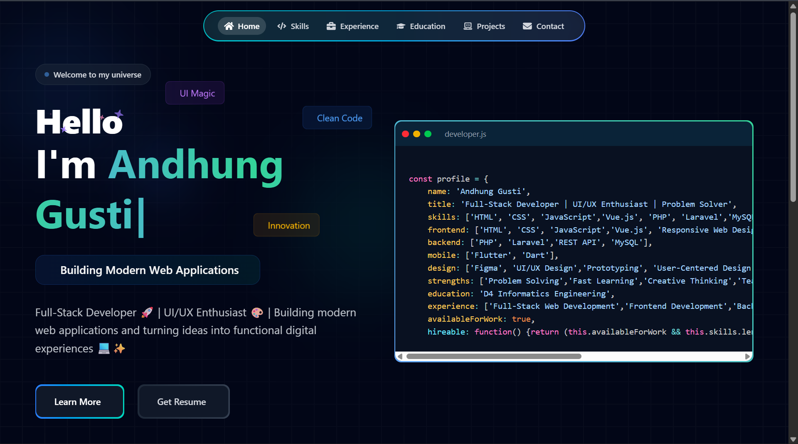

# Andhung Gusti — Portfolio Website

<div align="center">

  <h3>Web Developer | UI/UX Designer | Technology Enthusiast</h3>

  Personal portfolio website showcasing my skills, experience, certifications, and projects in web development and UI/UX design.

</div>

---

## 📸 Portfolio Preview

<div align="center">

  

</div>

---

## 🌐 Live Preview

- **Portfolio:** Add your deployed portfolio URL
- **GitHub:** [akusuma11](https://github.com/akusuma11)
- **LinkedIn:** [Andhung Gusti](https://linkedin.com/in/andhung-gusti-92916b296/)

---

## 👨‍💻 About Me

Hello! I'm **Andhung Gusti**, a Web Developer with an interest in building modern, responsive, and user-friendly digital experiences.

I focus on web development and UI/UX design, combining functionality, performance, and clean interface design to create effective digital solutions.

This portfolio showcases my technical skills, experience, certifications, and selected projects.

---

## 🎯 Portfolio Sections

- **Home:** Personal introduction and professional profile.
- **Skills:** Technical skills, programming languages, frameworks, and development tools.
- **Experience:** Internship experience and practical project contributions.
- **Education & Certifications:** Educational background and professional certifications.
- **Projects:** Selected web development, mobile application, and UI/UX projects.
- **Contact:** Contact information and professional networking links.

---

## 🛠️ Technologies & Skills

### Programming Languages
- HTML
- CSS
- JavaScript
- PHP

### Frameworks & Development
- React.js
- Vue.js
- Laravel
- Flutter

### Database
- MySQL

### UI/UX Design
- Figma
- Wireframing
- Prototyping
- Responsive Interface Design

### Tools
- Git
- GitHub
- Visual Studio Code

---

## 🚀 Featured Projects

### 1. UniEvent — Event Booking Platform

A web-based event management and ticket booking platform that supports event publication, participant registration, ticket reservations, and event administration for events across Indonesia.

**Focus:** Web Development, UI/UX Design, Event Management.

### 2. Plantify

A digital project related to plants, focusing on usability, interface design, and functionality.

**Focus:** Web Development, UI/UX Design.

### 3. Eviasi — Automotive Service Booking Application

An application concept for booking car detailing and vehicle customization services, helping users explore services and manage their vehicle care needs.

**Focus:** Application Development, UI/UX Design.

### 4. Epic Story Mobile

A mobile learning application designed to support elementary school students through interactive learning materials, books, and flashcards.

**Focus:** Flutter, Mobile UI/UX Design.

### 5. Apotek Sehat

A web development project related to pharmacy services and information management.

**Repository:** [View on GitHub](https://github.com/akusuma11/Apotek-Sehat)

---

## 💼 Experience

### UI/UX Design Internship — PT Pyxis Ultimate Solution

**Period:** July – November 2025

Worked on the UI/UX design of UniEvent, a web-based event ticket booking platform for hotel events.

Responsibilities:
- Designed website interfaces and user flows in Figma.
- Created wireframes and interactive prototypes.
- Refined interface layouts based on evaluation and feedback.
- Collaborated with team members throughout the design process.

---

## 🎓 Education & Certifications

My educational background and certifications support my development skills and commitment to continuous learning.

### Certifications
- BNSP — Web Developer
- DBS Coding Camp / Dicoding — Relevant completed courses and certifications.

---

## 💻 Technologies Used

- **Frontend:** React.js, Vite
- **Styling:** Tailwind CSS
- **Animations:** Framer Motion
- **Icons:** Lucide React / React Icons
- **Development Tools:** Git, GitHub, Visual Studio Code
- **Deployment:** Vercel

---

## 📂 Project Structure

```text
portfolio/
├── public/
├── src/
│   ├── assets/
│   │   ├── css/
│   │   └── images/
│   ├── components/
│   ├── pages/
│   ├── App.jsx
│   └── main.jsx
├── index.html
├── package.json
├── vite.config.js
└── README.md
```

---

## ⚙️ Installation

### Prerequisites

- [Node.js](https://nodejs.org/)
- [Git](https://git-scm.com/)

Verify the installation:

```bash
node --version
npm --version
git --version
```

### 1. Clone the Repository

```bash
git clone https://github.com/akusuma11/portfolioku.git
```

### 2. Navigate to the Project Directory

```bash
cd portfolioku
```

### 3. Install Dependencies

```bash
npm install
```

### 4. Start the Development Server

```bash
npm run dev
```

### 5. Open the Website

Visit the local URL displayed in your terminal, usually:

```text
http://localhost:5173/
```

---

## 🚀 Deployment

This portfolio can be deployed using [Vercel](https://vercel.com/).

1. Push the project to GitHub.
2. Import the repository into Vercel.
3. Set the build command to `npm run build`.
4. Set the output directory to `dist`.
5. Deploy the project.

---

## 📬 Contact

- **GitHub:** [akusuma11](https://github.com/akusuma11)
- **LinkedIn:** [Andhung Gusti](https://linkedin.com/in/andhung-gusti-92916b296/)

For professional opportunities, web development projects, and collaboration, feel free to connect with me.

---

<div align="center">

  **Designed and developed by Andhung Gusti**

  *Building useful digital experiences through web development and thoughtful design.*

</div>
